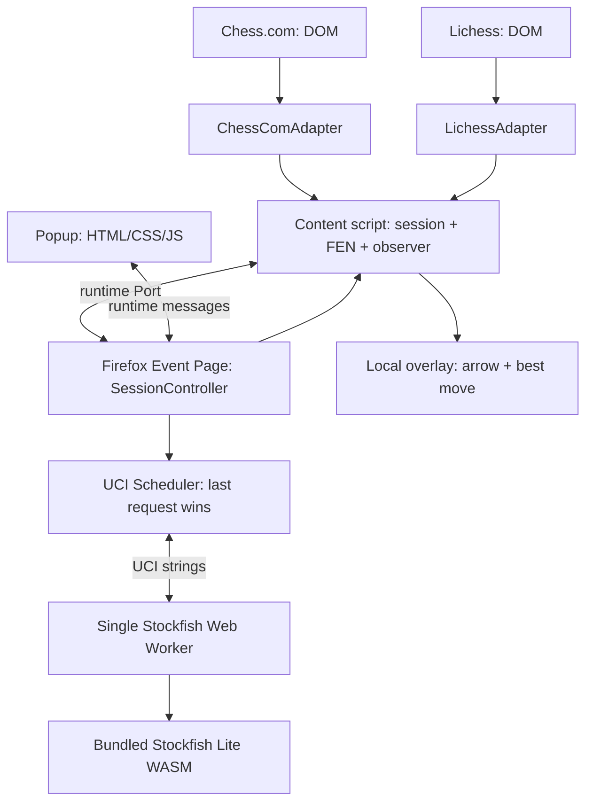

# chkd — архитектура лёгкого Firefox-расширения

> Текущее изменение по запросу оператора: добавлен выключенный по умолчанию Auto move с автоматическим определением стороны игрока. Оператор выбирает тестовую партию; режим ai/human/unknown не используется для разрешения автохода. Сохраняются проверки легальности, активной сессии, стороны, актуальности позиции и подтверждение результата. Исходные ограничения и этап 6 ниже относятся к первоначальной спецификации.

> **Версия спецификации:** 1.0  
> **Дата:** 7 ноября 2026  
> **Цель:** локальный анализ шахматных позиций Stockfish в Firefox на Chess.com и Lichess, с минимальными затратами ресурсов и компактным интерфейсом.  
> **Статус:** техническое задание и архитектура для реализации. Это **не готовое расширение**: ниже описаны структура, контракты, алгоритмы и критерии приёмки.

## 0. Границы применения

- **Chess.com, партии с компьютерными ботами:** Fair Play Policy Chess.com исключает игры против встроенных компьютерных ботов из общего запрета на подсказки движка. Возможность автоматического взаимодействия с GUI нужно отдельно оценивать по условиям использования сайта.
- **Lichess, партии против встроенного ИИ:** анализ Stockfish разрешён; **программное выполнение ходов через интерфейс запрещено**, даже против встроенного ИИ. Для него реализуется чтение позиции и отображение анализа, но не автоход.
- **Lichess, партии с аккаунтом-ботом:** правила обычной игры строже, чем для встроенного ИИ. Не включать живые подсказки в такие партии. Официальная автоматизация доступна через Bot API, для которого нужен токен.
- **Люди, рейтинговые и обычные онлайн-партии:** никаких подсказок или автоходов во время игры. Для тестирования полной автономной игры — собственная шахматная страница или разрешённый локальный стенд.
- Не добавлять обход обнаружения, скрытие активности, маскировку под человека или работу на неподдерживаемых экранах.

## 1. Требования

### Функциональные

1. Firefox Desktop, Manifest V3.
2. Два независимых адаптера чтения: `ChessComAdapter`, `LichessAdapter`.
3. Распознавать режим страницы и разрешать анализ **только в поддерживаемом контексте**.
4. Собирать **полноценный FEN**, включая очередь хода, рокировки, взятие на проходе и счётчики; учитывать историю партии.
5. Анализировать позицию локально через Stockfish.js WebAssembly по протоколу UCI.
6. Возвращать лучший ход в UCI, оценку и глубину анализа; показывать результат компактно.
7. Настройки: Вкл./Выкл., `movetime` (100/300/1000 мс), Hash (8/16/32 МБ), показывать стрелку или только текст.
8. Останавливать устаревший поиск при изменении позиции и не отображать устаревшие ответы.
9. Одна активная аналитическая сессия на всё расширение; не создавать движок на каждую вкладку.
10. Полностью освобождать Worker при выключении и после простоя.

### Нефункциональные

- **Никакого сервера, облака, API-токенов, сетевых запросов движка.**
- **Без React, Tailwind, WXT и постоянного runtime npm.** Только JS/HTML/CSS + скомплектованный WASM и небольшая локальная библиотека правил.
- Не использовать `setInterval()` для постоянного опроса страницы.
- Не анализировать до загрузки или после отключения.
- Не делать перманентного сканирования всего DOM: наблюдать только дерево шахматной доски и, при необходимости, историю ходов.
- Тёмный popup с системным шрифтом; без анимаций, сторонних иконок и внешних ресурсов.

## 2. Технологии и зависимости

| Уровень | Реализация | Обоснование |
|---|---|---|
| Расширение | Firefox WebExtensions Manifest V3 | Нативный стандарт Firefox |
| Код | Vanilla JavaScript | Нет фреймворка и инфраструктуры сборки |
| Фоновая логика | Firefox Event Page (`background.scripts`) | Обработка сообщений и планирование движка |
| Анализ | Stockfish 19 Lite Single-Threaded (`.js` + `.wasm`) | Примерно 1,7 МБ на диске, не требует COOP/COEP |
| Вычисления | Один Web Worker | Не блокирует UI/контентную страницу |
| Шахматные правила | Локальная, зафиксированная browser-сборка `chess.js` | Валидация ходов, SAN/UCI и полного FEN |
| Интеграция | Content Scripts + DOM/MutationObserver | Не нужно компьютерное зрение |
| Сообщения | `browser.runtime.connect()` и `Port` | Явный жизненный цикл сессии |
| Хранение | `browser.storage.local` | Сохранение только параметров |
| UI | HTML + CSS + JS | Минимум памяти и файлов |

**Уточнение:** отсутствие npm-зависимостей **во время исполнения** не означает, что Stockfish и `chess.js` не являются сторонним кодом. Их файлы включаются в пакет расширения локально. Для подготовки browser-сборки `chess.js` можно использовать однократный шаг сборки, после чего Firefox запускает расширение без Node.js и сборщика.

## 3. Схема компонентов



### Распределение ответственности

- **Content Script:** определяет сайт и допустимый контекст, извлекает ходы/позицию, проверяет FEN, наблюдает за изменениями, показывает результат. Не запускает тяжёлые вычисления.
- **Site Adapter:** знает только DOM конкретного сайта, структуру истории, ориентацию доски и режим партии. Никакого UCI или управления Worker.
- **SessionController в Event Page:** владеет портами вкладок, активной сессией, настройками, кешем, жизненным циклом Worker. Не зависит от селекторов сайтов.
- **EngineController:** UCI-состояния `STOPPED → BOOTING → READY → SEARCHING → READY`, очередь запросов, таймауты, перезапуск при ошибке.
- **Popup:** только интерфейс и сохранение параметров. Закрытие popup не влияет на анализ.
- **Overlay:** отображение результата; никак не влияет на состояние шахматной доски.

## 4. Файловая структура

```text
knight-engine/
├── manifest.json
├── background/
│   ├── background.js          # onConnect/onMessage, регистрация обработчиков
│   ├── sessions.js            # один активный сеанс
│   ├── engine.js              # Worker + UCI state machine
│   └── config.js              # значения по умолчанию
├── content/
│   ├── content.js             # входная точка, observer, connection
│   ├── position.js            # полное FEN, история, fingerprint
│   ├── overlay.js             # минимальный вывод
│   └── adapters/
│       ├── chesscom.js
│       └── lichess.js
├── popup/
│   ├── popup.html
│   ├── popup.js
│   └── popup.css
├── vendor/
│   ├── chess-rules.iife.js    # локальная браузерная сборка chess.js
│   └── stockfish/
│       ├── stockfish-19-lite-single.js
│       └── stockfish-19-lite-single.wasm
├── icons/
│   └── icon-48.png
└── LICENSES.md
```

Порядок загрузки JS важен: вспомогательные файлы, которые используют глобальные переменные или IIFE, нужно подключать **до** скрипта, который их вызывает. Импорты ES-модулей из обычных `background.scripts`/content scripts не предполагаются. Для более строгой модульности исходники можно собрать в два простых файла (`background.js`, `content.js`), но это необязательно для первого прототипа.

## 5. `manifest.json`: базовая конфигурация Firefox MV3

```json
{
  "manifest_version": 3,
  "name": "Knight Engine",
  "version": "0.1.0",
  "description": "Local chess analysis powered by Stockfish",
  "browser_specific_settings": {
    "gecko": {
      "id": "knight-engine@example.invalid",
      "strict_min_version": "140.0",
      "data_collection_permissions": {
        "required": ["none"]
      }
    }
  },
  "permissions": ["storage"],
  "host_permissions": [
    "https://www.chess.com/*",
    "https://lichess.org/*"
  ],
  "background": {
    "scripts": [
      "background/config.js",
      "background/engine.js",
      "background/sessions.js",
      "background/background.js"
    ]
  },
  "action": {
    "default_title": "Knight Engine",
    "default_popup": "popup/popup.html"
  },
  "content_scripts": [
    {
      "matches": [
        "https://www.chess.com/*",
        "https://lichess.org/*"
      ],
      "js": [
        "vendor/chess-rules.iife.js",
        "content/adapters/chesscom.js",
        "content/adapters/lichess.js",
        "content/position.js",
        "content/overlay.js",
        "content/content.js"
      ],
      "run_at": "document_idle",
      "all_frames": false
    }
  ],
  "content_security_policy": {
    "extension_pages": "script-src 'self' 'wasm-unsafe-eval'; object-src 'self'; worker-src 'self';"
  }
}
```

**Замечания:**

- ID `knight-engine@example.invalid` — **пример**, перед публикацией заменить на свой уникальный идентификатор.
- `strict_min_version: 140.0` выбран как современная поддерживаемая версия, **не является доказанным техническим минимумом** для всех компонентов. Можно снизить только после тестирования.
- Для размещения на AMO информация о сборе данных обязательна; `required: ["none"]` соответствует заявленной полностью локальной реализации, если действительно нет передачи данных.
- Для WebAssembly необходим `'wasm-unsafe-eval'`; он **не означает** разрешения обычного `eval()`.
- Не запрашивать `tabs`, `webRequest`, `nativeMessaging`, `<all_urls>` без реальной необходимости.
- Доступ к страницам может быть отключён пользователем в менеджере разрешений Firefox; нужен понятный статус `NO_PERMISSION`.

## 6. Контракт адаптера сайта

Каждый адаптер должен поддерживать одинаковый интерфейс (здесь — псевдоинтерфейс JavaScript):

```js
const adapter = {
  id: "chesscom",                        // или "lichess"
  detect(location, document) {},          // сайт и поддерживаемый экран
  getGameMode() {},                       // ai | analysis | human | unknown
  getBoardRoot() {},                      // DOM-узел доски либо null
  getMoveHistory() {},                    // SAN/UCI ходов с начала игры
  getInitialPosition() {},                // startpos либо явный стартовый FEN
  getOrientation() {},                    // white | black | unknown
  getGameIdentity() {},                   // устойчивый id текущей партии
  observeChanges(onChange) {},            // возвращает dispose()
  readDisplayedPosition() {}              // резервная проверка фигур
};
```

`getGameMode()` обязан **fail closed**: `unknown` не разрешает анализ живой партии. Только явно распознанный AI/analysis-контекст. Вводит защиту от случайной активации на партиях против людей.

### Извлечение позиции: порядок источников

1. Если страница предоставляет полноценный корректный FEN в доступном DOM/атрибуте — проверить и использовать.
2. Иначе: получить стартовую позицию и **полную историю ходов**, прогнать её через локальную библиотеку правил, получить `fen()`.
3. Дополнительно сверить полученную доску с расположением фигур в DOM (если оно доступно).
4. Если история недоступна или неполная, **не собирать вымышленный FEN из одних фигур**. Выдать `POSITION_UNCERTAIN` и отключить анализ до восстановления данных.

Почему это важно: расположение фигур не кодирует право рокировки, en passant, полуходы, номер хода. Кроме того, после смены партии нельзя продолжать старую историю.

### Изменчивость сайтов

DOM Chess.com/Lichess может измениться без предупреждения. Селекторы, парсинг списка ходов, определение режима и ориентации должны быть изолированы в соответствующем адаптере и покрыты fixture-тестами. Спецификация **не утверждает**, что конкретные селекторы навсегда стабильны; их проверяют на актуальных страницах при разработке.

## 7. Наблюдение за изменениями без polling

**Один `MutationObserver` на доску** и, если требуется, ещё один на контейнер истории ходов. При ререндере сайта старые observers отключаются.

Алгоритм:

```text
DOM mutation
  ↓
requestAnimationFrame / debounce 50–100 мс
  ↓
adapter.getMoveHistory() + построение FEN
  ↓
валидация и fingerprint позиции
  ↓
fingerprint прежний? → пропустить
  ↓ нет
POSITION_CHANGED → Port → SessionController
```

- `fingerprint = gameId + ':' + fullFen + ':' + settingsRevision`.
- Не наблюдать `document.body` постоянно: временный широкий observer допустим **только для поиска корня доски**, после чего переключиться на узкий.
- `requestAnimationFrame` лучше не считать гарантированным на фоновой вкладке: если нужно обновление в фоне, использовать небольшое запланированное `setTimeout()` *после события MutationObserver*, не бесконечный интервал.
- При `visibilitychange`, SPA-навигации, размонтировании доски или окончании партии пересчитать доступность и сообщить об остановке сессии.

## 8. Протокол сообщений

Всё общение между контентом и Event Page — через один `Port`, созданный `browser.runtime.connect({ name: "knight:session" })`.

Общие поля каждого сообщения:

```json
{
  "type": "POSITION_CHANGED",
  "v": 1,
  "sessionId": "random-per-navigation",
  "revision": 17,
  "payload": {
    "gameId": "example-game-id",
    "mode": "ai",
    "fen": "rnbqkbnr/pppppppp/8/8/8/8/PPPPPPPP/RNBQKBNR w KQkq - 0 1"
  }
}
```

Типы сообщений:

| Направление | Type | Назначение |
|---|---|---|
| Content → Background | `HELLO` | Сайт, вкладка, режим, идентификатор сессии |
| Content → Background | `POSITION_CHANGED` | Новый валидный FEN |
| Content → Background | `GAME_ENDED` | Остановить поиск |
| Content → Background | `DISABLE_SESSION` | Прекратить работу |
| Background → Content | `SESSION_STATUS` | `disabled/ready/thinking/error` |
| Background → Content | `ENGINE_RESULT` | Лучший ход, оценка, глубина, версия позиции |
| Background → Content | `ERROR` | Безопасное описание ошибки |
| Popup → Background | `GET_STATUS` | Узнать статус без чтения данных напрямую |
| Popup → Background | `SET_CONFIG` | Изменить разрешённые настройки |
| Popup → Background | `SET_ACTIVE_TAB` | Явно выбрать сессию для анализа |

Обязательная защита от устаревших сообщений: результат отображается **только если совпадают** `sessionId`, `gameId`, `revision` и `fen` (либо его строгий fingerprint). Не доверять полям из DOM как разрешению на выполнение действий.

## 9. Управление сессиями

Движок **единственный** на всё расширение. При одновременном открытии нескольких шахматных вкладок:

1. Активная аналитическая вкладка выбирается явно из popup.
2. Все остальные вкладки могут наблюдать изменения, но не ставят поиск в очередь.
3. Смена выбранной вкладки → `stop`, ожидание `bestmove`, затем новый `position`/`go`.
4. При закрытии порта активной вкладки → остановка, удаление активной сессии.
5. Если ни одна сессия не активна → уничтожить Worker сразу либо после небольшого таймаута простоя (например 30 с).

В Firefox MV3 Event Page может выгружаться, когда становится неактивной. Долгоживущий `Port` во время активного анализа помогает поддерживать её жизнь; **нельзя** полагаться на сохранность глобальных JS-переменных после выгрузки. После перезапуска Event Page конфигурация восстанавливается из `storage.local`, сессии переподключаются, Worker создаётся повторно по требованию.

## 10. Stockfish Worker и UCI

Worker создаётся **только при первой необходимости**:

```js
const workerUrl = browser.runtime.getURL(
  "vendor/stockfish/stockfish-19-lite-single.js"
);
const worker = new Worker(workerUrl);
```

Рядом с JS должен лежать соответствующий `.wasm` файл **той же сборки**. Команды UCI отправляются обычными строками через `worker.postMessage()`.

### Инициализация

```text
create Worker
→ "uci"
← "id ..." / "option ..." / "uciok"
→ "setoption name Hash value 16"
→ "setoption name MultiPV value 1"
→ "isready"
← "readyok"
state = READY
```

### Запрос анализа

```text
state = READY
→ "position fen <FULL_FEN>"
→ "go movetime 300"
state = SEARCHING
← "info depth 12 score cp 25 ..."
← "bestmove e2e4 ponder ..."
state = READY
```

`movetime` задаёт ограничение по времени, но не жёсткую гарантию миллисекундной задержки. `Threads` у single-threaded-версии не настраивается.

### Отмена устаревшего поиска — критически важно

UCI не прикрепляет `requestId` к выводу движка. Нельзя просто отправить `stop`, сразу начать новый поиск и приписать первый полученный `bestmove` новому FEN.

Правильный алгоритм:

```text
получен новый POSITION_CHANGED во время SEARCHING:
  latestPending = новый запрос (заменить предшествующий pending)
  отправить "stop" ровно один раз
  перейти в STOPPING

получен "bestmove" текущего поиска:
  если запрос устарел → не показывать
  перейти в READY
  если latestPending существует → отправить position/go для него

если "bestmove" не пришёл до watchdog timeout:
  worker.terminate()
  создать новый Worker
  инициализировать UCI заново
  выполнить latestPending, если он всё ещё актуален
```

Кеш (необязательный): небольшая LRU-таблица на 16–32 результатов; ключ включает FEN, время поиска и конфигурацию движка. На первое время кеш можно не делать: простота важнее экономии единичных сотен миллисекунд.

### Разбор ответа UCI

- Лучший ход: `bestmove <uci>`; возможен `(none)` в терминальной позиции.
- Оценка: `info ... score cp N` либо `score mate N`; учитывать перспективу стороны, которая ходит, при показе «за белых».
- Глубина: `info ... depth N`.
- Показывать последнюю релевантную оценку, но **не выдавать промежуточный principal variation за финальный `bestmove`**.
- Валидировать, что полученный ход легален относительно переданного FEN, прежде чем отображать или исполнять в собственном тестовом стенде.

## 11. UI: минимальный popup

Габариты: примерно 260×220 px. Системный шрифт, тёмная тема, без иконовых пакетов и анимаций.

```text
┌─────────────────────────┐
│ KNIGHT ENGINE     [ON]  │
│ Stockfish 19 Lite       │
│                         │
│ Site: Lichess / AI      │
│ Status: Ready           │
│ Best: Nf3   Depth: 13  │
│                         │
│ Time:  [100][300][1000]│
│ Hash:  [8][16][32] MB  │
│ [Show move on board]    │
└─────────────────────────┘
```

- `popup.js` читает статус из Background, записывает настройки через единый `SET_CONFIG` и `storage.local`.
- Popup не держит Worker и не запускает анализ сам по себе.
- Overlay добавляет один контейнер/стрелку поверх доски и обновляет его только при новых результатах.
- Визуальную стрелку нужно вычислять по DOM-геометрии клетки и ориентации доски; пересчитывать при `ResizeObserver` и смене ориентации.
- Стрелка — `pointer-events: none`, чтобы не блокировать клики пользователя.

## 12. Настройки и значения по умолчанию

```json
{
  "enabled": false,
  "movetimeMs": 300,
  "hashMb": 16,
  "multiPv": 1,
  "showArrow": true,
  "showEval": true,
  "keepWorkerWarmMs": 30000
}
```

Диапазоны проверяются в Background, а не только в popup. `movetimeMs ∈ {100, 300, 1000}`; `hashMb ∈ {8, 16, 32}`. Параметры, способные поменять Worker-конфигурацию, применяются **после завершения текущего поиска** или после корректной остановки.

## 13. Производительность

| Показатель | Проектный ориентир | Как проверить |
|---|---:|---|
| Размер JS+WASM Stockfish Lite single | ≈1,7 МБ на диске | Размер файлов из релиза |
| Бюджет собственных JS/CSS | 20–50 КБ без библиотеки правил | Сумма/сжатый пакет |
| Рабочих Stockfish Workers | 1 | Firefox DevTools |
| Нагрузка от Stockfish в режиме OFF | 0% CPU от поисковых задач | Firefox Task Manager |
| Задержка от DOM-изменения до постановки запроса | Цель ≤100 мс | `performance.now()` |
| Стандартное время поиска | 300 мс + служебные задержки | Лог `go`/`bestmove` |
| Кеш | 0–32 последних позиций | Контроль памяти |

**Не путать 1,7 МБ на диске с потреблением RAM:** WebAssembly, поисковая хеш-таблица и накладные расходы Worker требуют существенно больше памяти. Замерять пиковую RAM в Firefox обязательно.

### Что не делать

- Не пересоздавать Worker каждый ход.
- Не запускать по движку на каждую вкладку.
- Не искать несколько вариантов (`MultiPV > 1`) в режиме максимальной скорости.
- Не использовать скриншоты, OCR, canvas-пиксели или серверную обработку.
- Не запускать анализ по каждой DOM-мутации без дедупликации.
- Не хранить лог всей партии или тысячи `info`-сообщений в Background.

## 14. Обработка ошибок

| Код | Условие | Реакция |
|---|---|---|
| `NO_PERMISSION` | Нет доступа к хосту | Показать инструкцию, не запускать Worker |
| `UNSUPPORTED_CONTEXT` | Сайт/режим не распознан | Не анализировать |
| `BOARD_NOT_FOUND` | Не удалось найти доску | Повторная инициализация по DOM-событию |
| `POSITION_UNCERTAIN` | Неполная история или противоречивая позиция | Не отправлять FEN в движок |
| `ENGINE_BOOT_FAILED` | Не загрузился JS/WASM или нет `uciok` | Один повтор, затем отключить анализ |
| `ENGINE_TIMEOUT` | Нет `bestmove` после `stop` | `terminate()`, безопасный рестарт |
| `STALE_RESULT` | Ответ не соответствует revision | Отбросить молча |
| `SESSION_CLOSED` | Вкладка закрылась/отключилась | Остановить и выгрузить Worker |
| `GAME_OVER` | Мат/пат/завершение партии | Очистить стрелку и остановить анализ |

Ошибки DOM не должны приводить к отправке «почти правильного» FEN. Нельзя автоматически выполнять ход после неверно распознанной позиции.

## 15. Защита данных и безопасность

- Вся обработка выполняется локально; ни FEN, ни история партии не отправляются в интернет.
- Не подключать внешние CDN, трекеры или удалённые скрипты.
- Все файлы движка хранить **внутри расширения**.
- У каждого сообщения проверять тип, версию протокола, размер FEN, разрешённый режим и текущую сессию.
- `textContent`, а не `innerHTML`, для вывода позиции и ошибок.
- Минимизировать host permissions; разрешения пользователя могут быть отозваны.
- В `storage.local` хранить только настройки, не историю игр.
- Не использовать `eval`, динамическое выполнение полученных с сайта строк или небезопасную CSP.

## 16. Тестирование

### Unit-тесты

- Стартовая позиция, рокировки KQkq, en passant, превращение пешки.
- Полная партия по SAN и UCI, восстановление после обновления страницы.
- Валидность/невалидность FEN и сверка доски с DOM.
- Повторный `POSITION_CHANGED` не запускает новый поиск.
- `stop` + устаревший `bestmove` не отображается для нового запроса.
- `bestmove (none)` и прекращение партии.
- Изменение `movetime`/Hash в ходе поиска.

### Интеграционные тесты

1. Загрузка временного расширения из `about:debugging` → **This Firefox → Load Temporary Add-on** → `manifest.json`.
2. Открыть поддерживаемый анализируемый режим сайта; проверить получение валидного FEN.
3. Подключить Port; получить `uciok`, `readyok` и первый `bestmove`.
4. Сделать следующий ход вручную: предыдущий результат должен быть отклонён.
5. Открыть вторую вкладку и переключить активную сессию: Worker остаётся один.
6. Закрыть вкладку: поиск останавливается, память освобождается.
7. Выключить расширение: CPU поисковых задач становится нулевым.
8. Обновить страницу SPA/перевернуть доску: overlay переориентируется.
9. Проверить невозможность активации на игре против человека.
10. Проверить работу после выгрузки/перезапуска Event Page.

### Критерии приёмки

- Не менее 20 тестовых позиций проходят реконструкцию истории без потери FEN-полей.
- 100 последовательных обновлений позиции без ошибок привязки результатов.
- Не больше одного активного Stockfish Worker.
- Нет сетевых запросов к внешним серверам.
- При отключении или закрытии последней сессии Worker уничтожен.
- Неподдерживаемые игровые режимы не запускают анализ.

## 17. Порядок разработки

**Этап 1 — ядро движка.** Поднять Firefox MV3 с popup и Event Page; заставить локальный Worker отвечать `bestmove` на заранее заданный FEN. Добавить `stop`, watchdog и выключение.

**Этап 2 — контракт позиции.** Подключить зафиксированную библиотеку правил, реализовать восстановление FEN из списка ходов, 20 fixture-тестов.

**Этап 3 — один сайт.** Сначала Lichess Analysis Board / игра со встроенным ИИ: чтение позиции, dedupe, обновление вывода, без автохода. Проверить реальный DOM.

**Этап 4 — Chess.com.** Добавить независимый адаптер для явно распознанного режима встроенных ботов, с теми же контрактами ошибок и правилами безопасной активации.

**Этап 5 — UI и оптимизация.** Добавить компактный popup, стрелку, кэш и измерения CPU/RAM. Избавляться от зависимостей только после профилирования.

**Этап 6 — автономное исполнение в собственной среде.** Сделать отдельный `MoveExecutor` **только** для собственной доски или иной среды с разрешённой автоматизацией. Он принимает подтверждённый легальный UCI-ход, выполняет его через публичный контракт собственного UI и ждёт подтверждения новой позиции, прежде чем анализировать снова. Для Lichess GUI такой исполнитель не включать.

## 18. Зависимости, лицензии и публикация

- Stockfish.js / Stockfish: **GPL-3.0**. При распространении соблюдать требования GPL, включая предоставление соответствующих исходников и лицензии.
- `chess.js`: выбрать конкретную версию, проверить лицензию и включить уведомление в `LICENSES.md`.
- Для публикации Firefox MV3 потребуется корректный Gecko ID и декларация о сборе данных. Отдельно проверить актуальные требования AMO к исходникам/сборке.
- Для проверки временного расширения в `about:debugging` подписанный XPI не требуется; для обычной установки/распространения действует процедура подписи Firefox.

## 19. Официальные источники

1. [Firefox MV3: `background` и Event Pages — MDN](https://developer.mozilla.org/en-US/docs/Mozilla/Add-ons/WebExtensions/manifest.json/background)
2. [Firefox: Background scripts и жизненный цикл — MDN](https://developer.mozilla.org/en-US/docs/Mozilla/Add-ons/WebExtensions/Background_scripts)
3. [Firefox: CSP и WebAssembly — MDN](https://developer.mozilla.org/en-US/docs/Mozilla/Add-ons/WebExtensions/Content_Security_Policy)
4. [Firefox: `browser_specific_settings` и data collection — MDN](https://developer.mozilla.org/en-US/docs/Mozilla/Add-ons/WebExtensions/manifest.json/browser_specific_settings)
5. [Stockfish.js: сборки, использование Worker, лицензия — GitHub](https://github.com/nmrugg/stockfish.js)
6. [Lichess: Fair Play и запрет programmatic GUI moves](https://lichess.org/page/fair-play)
7. [Chess.com: Fair Play Policy (исключение для компьютерных ботов)](https://www.chess.com/legal/fair-play)

---

**Архитектурное решение:** Vanilla JS + Firefox MV3 Event Page + один лениво загружаемый Stockfish 19 Lite Single-Threaded Worker + адаптеры DOM + восстановление полного FEN + минимальный popup. Основные риски не в производительности движка, а в изменчивом DOM сайтов, корректности реконструкции шахматного состояния и жизненном цикле асинхронных UCI-запросов.
